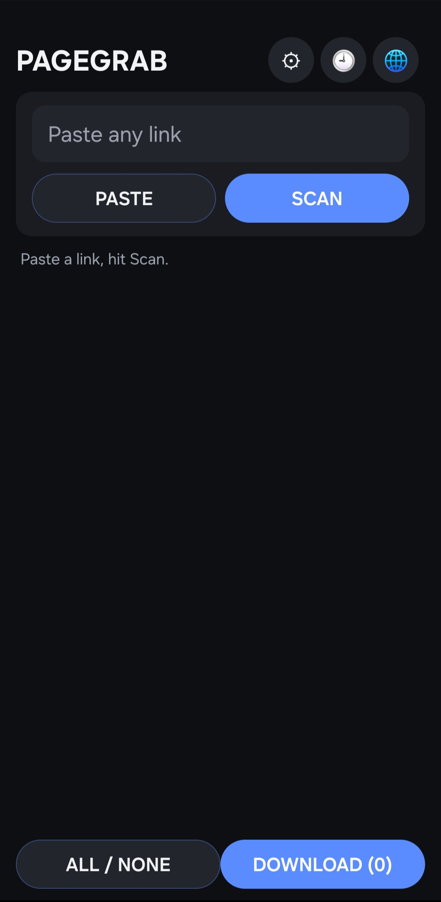
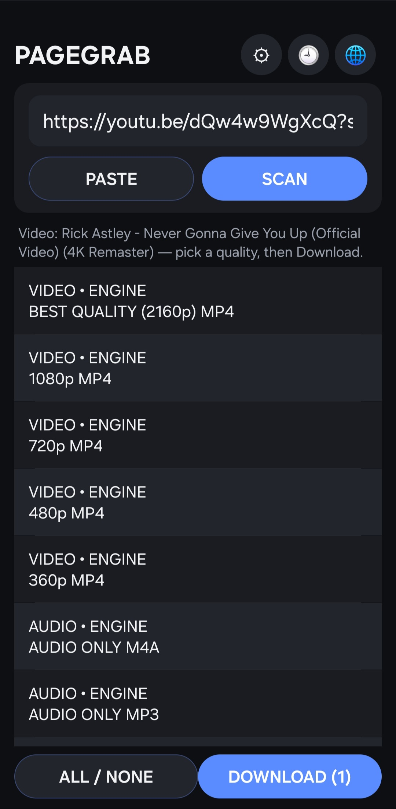
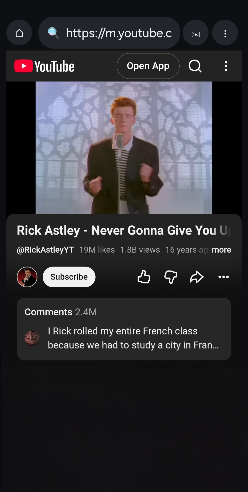
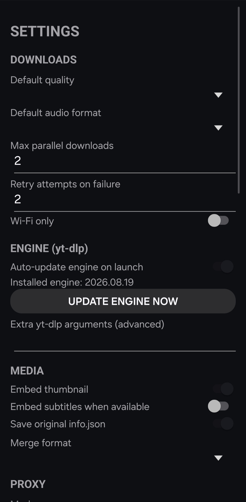

<div align="center">


# PageGrab

**Paste any link. Get the file.**

Video, audio, images, documents, or archives — from YouTube, TikTok, Instagram, X, and 1000+
other sites — straight to your phone. Free, open source, and ad-free.

[](https://github.com/beworkall/PageGrab/releases/latest)
[](https://github.com/beworkall/PageGrab/actions/workflows/build.yml)
[](LICENSE)

### [⬇️ Download the latest APK](https://github.com/beworkall/PageGrab/releases/latest)

</div>

---

## What it does

1. **Paste any link**, or share one to PageGrab from any app.
2. If it's a page yt-dlp knows (YouTube, TikTok, Instagram, X, SoundCloud, and 1000+ more),
   PageGrab's bundled engine asks what's on it and gives you a quality picker — best MP4, 1080p,
   720p, audio-only, and more.
3. If it's not a known site, PageGrab's **page sniffer** scans the page itself — hidden browser,
   network traffic, the works — and lists every video, audio, image, document, or archive it
   finds.
4. Pick what you want, hit Download. Everything lands in `Downloads/PageGrab/` with its original
   metadata intact.

## Screenshots

<!--
  Drop PNG/JPG screenshots into docs/screenshots/ with these exact names and they'll render below
  automatically. I can't capture live screenshots of the running app myself — grab these from
  your phone (long-press power + volume-down, or your screenshot shortcut) and drop them in.
-->
<div align="center">
<table>
<tr>
<td align="center"><br/><sub>Home — paste &amp; scan</sub></td>
<td align="center"><br/><sub>Pick a quality</sub></td>
<td align="center"><br/><sub>In-app browser</sub></td>
<td align="center"><br/><sub>Settings</sub></td>
</tr>
</table>
</div>

## Features

- 🌍 **Universal engine** — bundled yt-dlp + ffmpeg, 1000+ supported sites
- 🕵️ **Page sniffer fallback** — scans any other page for downloadable media
- 📥 **Background downloads** — a real queue with a progress notification, survives leaving the app
- 🌐 **Full in-app browser** — log into your own account so the engine can reuse the session
- 🕶 **Incognito mode** — nothing saved, ever, when it's on
- ✉ **Opt-in temp mail** — disposable address for signups, off by default, nothing auto-submitted
- 🧅 **Proxy support** — HTTP/SOCKS4/SOCKS5, with a built-in connection test
- 🗣 **10 languages**, with full RTL for Urdu/Arabic/Persian
- 🕘 **History** and a **Settings** screen for defaults, retries, and media options
- 🚫 **No ads, no analytics, no accounts, no tracking — ever**

## Install

1. Go to [**Releases**](https://github.com/beworkall/PageGrab/releases/latest) and download the
   latest APK.
2. Open it on your phone. Android may ask you to allow installs from this source once —
   that's normal for any app not from the Play Store.
3. Open PageGrab, paste a link, go.

> New builds publish automatically to the **latest** release every time this repo's `main` branch
> updates, so that link always has the newest version.

## Build it yourself

```bash
git clone https://github.com/beworkall/PageGrab.git
cd PageGrab
gradle assembleDebug
```
No Android Studio needed — this repo's GitHub Actions workflow (`.github/workflows/build.yml`)
builds it the same way on every push.

## Why open source

PageGrab bundles [yt-dlp](https://github.com/yt-dlp/yt-dlp) and
[ffmpeg](https://ffmpeg.org/), both GPL-licensed, so this project is GPL-3.0 too — anyone can read,
modify, and redistribute the source. See [LICENSE](LICENSE).

## Responsible use

Only download content you have the right to access and save. PageGrab doesn't bypass paid
subscriptions, DRM, or login walls you don't have an account for — see [SIGNING.md](SIGNING.md)
for the signing setup if you're building your own release.

## Status

This is an actively developed solo project — see [open issues](https://github.com/beworkall/PageGrab/issues)
for what's planned next (download queue UI, Material 3 polish, playlist support). Feedback and
pull requests welcome.
